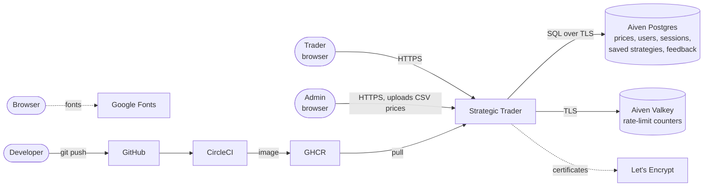
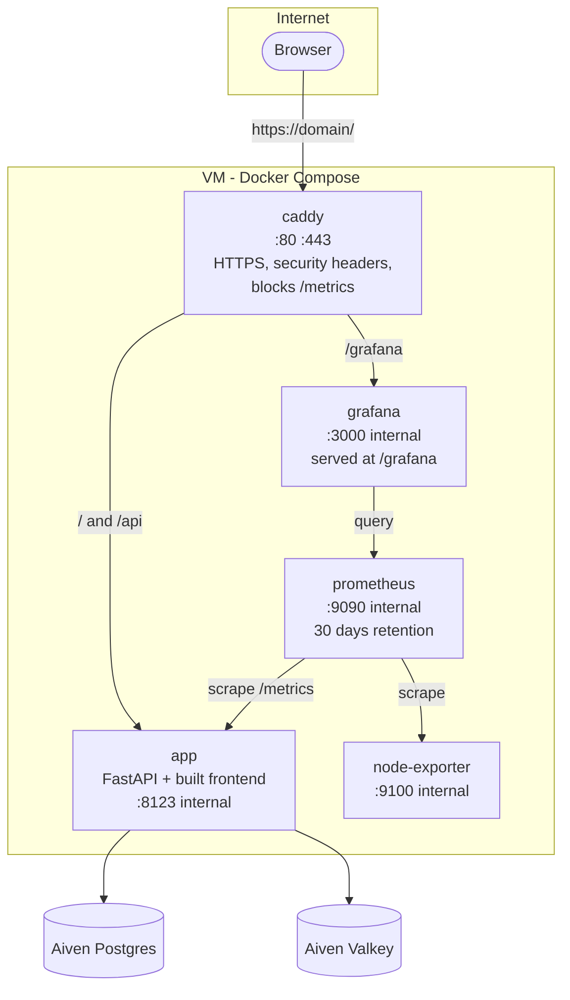
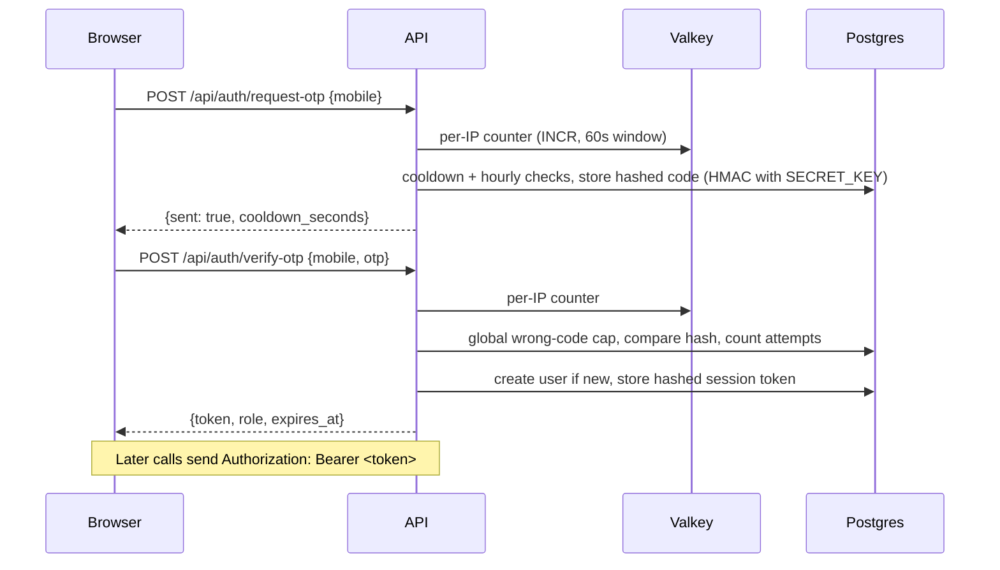
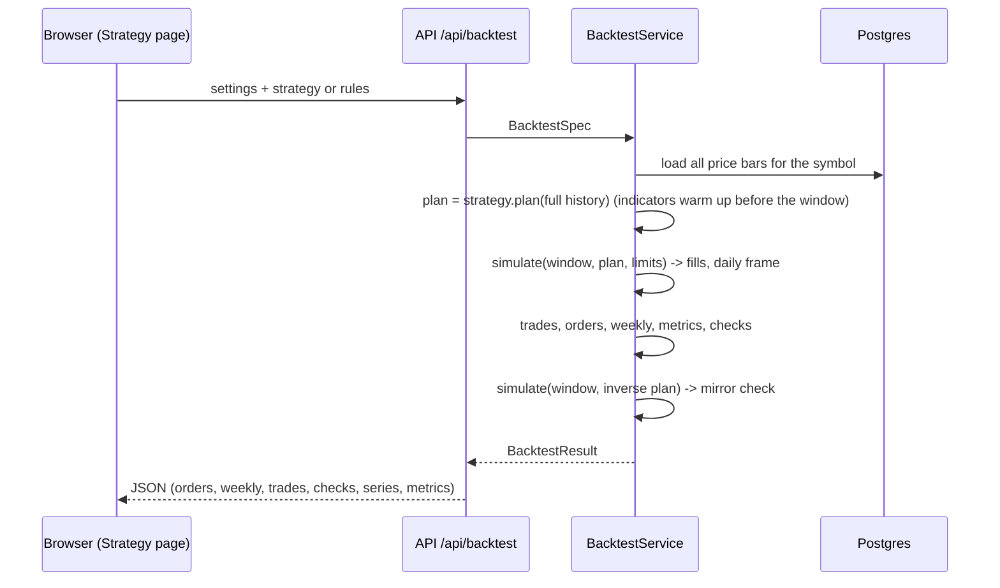
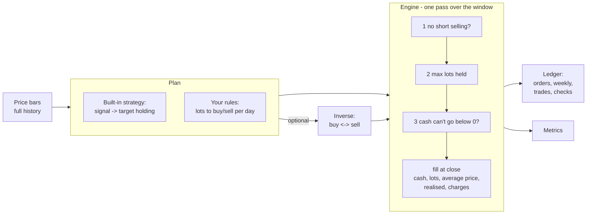
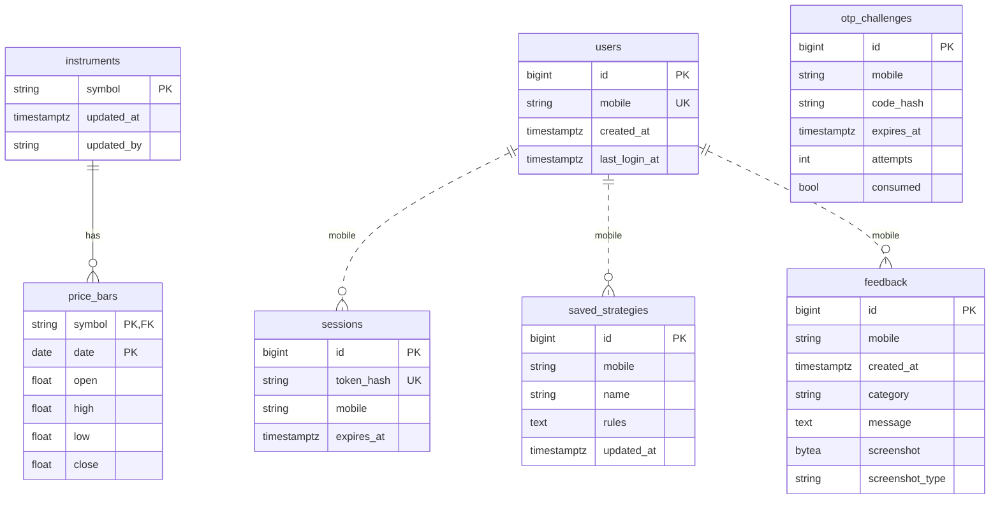
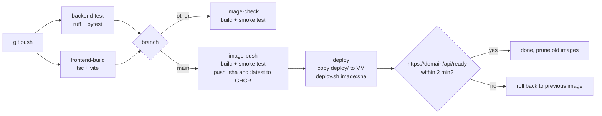

# Architecture

Strategic Trader runs trading rules on real price history and shows every number it produces in a form a person can check by hand. This document explains how the pieces fit together, how a backtest is computed, where data lives, and how it runs in production.

- [1. System context](#1-system-context)
- [2. Containers (production)](#2-containers-production)
- [3. Code structure](#3-code-structure)
- [4. How a request flows](#4-how-a-request-flows)
- [5. How a backtest is computed](#5-how-a-backtest-is-computed)
- [6. Data model](#6-data-model)
- [7. Configuration](#7-configuration)
- [8. Security](#8-security)
- [9. Observability](#9-observability)
- [10. Build and deploy](#10-build-and-deploy)
- [11. Limits and scaling](#11-limits-and-scaling)

Related: [API reference](api.md) · [Key design decisions](decisions.md) · [Runbook](runbook.md)

---

## 1. System context



| Who / what | Role |
|---|---|
| Trader | Signs in with a mobile number, tests rules, runs strategies, compares, saves rule sets, sends feedback |
| Admin | Everything a trader can do, plus uploads price data and reads feedback |
| Aiven Postgres | The only store of real data |
| Aiven Valkey (Redis-compatible) | Per-IP sign-in rate-limit counters, shared across app containers. Optional |
| GitHub → CircleCI → GHCR | Source, pipeline and image registry |
| Let's Encrypt | HTTPS certificates, obtained automatically by Caddy |
| Google Fonts | Inter and JetBrains Mono, loaded by the browser |

There are **no queues and no background workers**. Every backtest runs inside the HTTP request that asks for it.

---

## 2. Containers (production)

One VM runs everything with Docker Compose (`deploy/docker-compose.prod.yml`). The databases are managed services outside the VM.



| Container | Image | Exposed | Purpose |
|---|---|---|---|
| `app` | `ghcr.io/maheshwari-tech/finance-algo-trading:<git sha>` | internal 8123 | API and the built single-page frontend |
| `caddy` | `caddy:2.8-alpine` | 80, 443 | TLS, HTTP→HTTPS, security headers, routing; returns 404 for `/metrics` |
| `prometheus` | `prom/prometheus:v2.55.1` | internal | Scrapes app and host metrics, evaluates alert rules |
| `grafana` | `grafana/grafana-oss:11.3.0` | via Caddy at `/grafana` | Pre-provisioned data source and "Backtest Lab" dashboard |
| `node-exporter` | `prom/node-exporter:v1.8.2` | internal | CPU, memory and disk of the VM |

The app container runs as a non-root user, has a Docker healthcheck on `/api/ready`, and runs a single uvicorn worker (see [decision D-12](decisions.md#d-12-one-worker-per-container)).

---

## 3. Code structure

```
backend/app/
  main.py              create_app(): wires settings, DB, services, routers, metrics, static frontend
  config.py            Settings from environment (.env): secrets and infrastructure only
  appconfig.py         Tunable behaviour from config/*.json
  db.py                SQLAlchemy Core tables (Postgres in production, SQLite in tests)
  observability.py     JSON logs, Prometheus metrics, request middleware
  ratelimit.py         Per-IP limiter (Valkey/Redis, or in-process fallback)
  api/
    routes.py          HTTP endpoints, grouped: Operations, Sign-in, Catalog, Test a rule, Strategy, Saved, Feedback, Admin
    schemas.py         Request/response models (pydantic)
  auth/                mobile normalisation, OTP sender, AuthService (codes, sessions, limits), FastAPI dependencies
  data/
    sql_repository.py  Prices: list, load, save (replace/merge), delete
    validation.py      CSV parsing and checks
    saved.py           Saved rule sets per user
    feedback.py        Feedback storage, screenshot type check
  domain/              Pure calculation: no HTTP, no SQL
    strategies/        Built-in strategies (signal -> target holding) and indicators
    rules.py           Rule builder: operands, operators, explanations, CustomRulesStrategy
    engine.py          The trading engine: orders, limits, cash, average cost
    ledger.py          Orders, weekly rows, daily rows, weekly/monthly overviews, trades (position cycles), checks
    metrics.py         Totals, risk and trade statistics
    windows.py         Holding-window analysis
    periods.py         Period presets -> date range
    results.py         Result models returned to the frontend
  services/service.py  BacktestService: run(), test_rules(), inverse/mirror, charge sensitivity
frontend/src/
  main.ts              Router (hash based) and top bar
  pages/               testRule, dashboard (Strategy), compare, feedback, admin, login
  components/          controls, ruleBuilder, ledger (orders/weekly/trades/checks), overview (weekly/monthly overviews, daily transactions), pnl, metrics, insights
  charts/              Chart.js panels
  api/                 typed client and response types
config/                JSON: strategies, rule builder labels, analysis grids, auth limits, UI defaults, templates
deploy/                Compose stack, Caddyfile, Prometheus, Grafana, deploy and server setup scripts
scripts/               dev.sh, verify.sh, api-login.sh, export-openapi.sh
```

**Rule of the domain layer:** `domain/` knows nothing about HTTP, databases or the frontend. It takes price bars and settings and returns plain results. That is what lets the tests run every strategy against an independent reference calculator without a server.

---

## 4. How a request flows

### Sign-in



Codes and session tokens are stored only as hashes. Admin role comes from `ADMIN_MOBILES`, not from the database.

### Running a strategy



"Test a rule" (`/api/rule-test`) stops after the plan: it returns the days each rule fires, with the values, and never simulates money.

---

## 5. How a backtest is computed



**Two kinds of plan.** Built-in strategies say what they want to *hold* ("hold 2 lots"); the engine orders the difference from what is actually held whenever the target changes. Rule-builder rules say what to *do* ("buy 1 lot"); each firing is an order. Using targets for built-ins keeps them in sync when a limit blocks an order (see [D-04](decisions.md#d-04-built-in-strategies-plan-a-target-holding-rules-plan-orders)).

**Limits, in order:** short selling off → max lots held → cash can't go below 0 (buys are cut to what cash can pay for, charges included). Each limit that changes an order is written into that order's note.

**Accounting (average cost):**

| Quantity | Formula |
|---|---|
| Cash after an order | cash before − filled lots × price − charges |
| Average price | weighted average of the fills that opened or added to the position; unchanged when reducing; reset to the fill price when the position flips side |
| Realised P&L of an order | (price − average price) × lots closed × direction (+1 long, −1 short) |
| Open P&L | (close − average price) × lots held |
| Net worth | cash + lots held × close = starting capital + realised + open − charges |
| Most money in positions | max over days of \|lots held\| × average price |
| Most cash put in | starting capital − lowest cash (never below 0) |

**Trades** are position cycles: from 0 lots until back to 0, or until the position flips from long to short (the flipping order is split between the two trades, charges pro rata).

**Weeks** run Monday to Sunday and are labelled by the Monday. Weekly money columns are differences of rounded running totals, so the weeks add up to the totals to the paisa.

**Checks** are recomputed from the published rows on every run: cash per order, lots per order, net worth per day, the realised + open − charges identity per day, trades and weeks adding up to the totals, and the configured limits never being broken. The **mirror check** runs the inverse plan with the same limits; when no limit can block one side differently, strategy + inverse must equal −(charges of both).

**Verification in tests** (`backend/tests/test_reference.py`): a second calculator written separately (it tracks cost basis and walks one lot at a time) must agree with the engine on every day for every built-in strategy and every rule template, across five settings combinations, normal and inverse; plus hand-worked cases.

---

## 6. Data model



- Schema: `backend/app/db.py` (source of truth) and `backend/schema.sql` (same, for running by hand). `AUTO_CREATE_SCHEMA=true` creates missing tables on start; it never alters existing ones.
- On Postgres, row-level security is enabled on every table with no policies, so only the app's direct connection can read them (relevant if the database also exposes a REST API, as Supabase does).
- `saved_strategies.rules` is the rule set as JSON. Saved and feedback rows are keyed by mobile number; there are no foreign keys to `users` because a user row is created on first successful sign-in.
- Expired sessions are deleted on each sign-in; OTP challenges older than an hour past expiry are deleted on each code request.

---

## 7. Configuration

| Where | What | Examples |
|---|---|---|
| `.env` / server `.env` | Secrets and infrastructure | `DATABASE_URL`, `REDIS_URL`, `SECRET_KEY`, `ADMIN_MOBILES`, `ALLOWED_MOBILES`, `AUTH_MODE`, `OTP_DEV_CODE`, `APP_ENV`, `LOG_LEVEL` |
| `config/*.json` | Tunable behaviour, versioned with the code | strategy parameters, rule-builder labels and help, period presets, CSV limits, sign-in limits, UI defaults and thresholds, example rule sets |
| CircleCI contexts | Pipeline secrets | `ghcr`: `GHCR_USER`, `GHCR_TOKEN` · `production`: `DEPLOY_HOST`, `DEPLOY_USER` |

`APP_ENV=production` refuses a short `SECRET_KEY` or a guessable `OTP_DEV_CODE`, switches to JSON logs and hides Swagger.

---

## 8. Security

| Concern | Measure |
|---|---|
| Transport | HTTPS only (Caddy, HSTS); TLS to Postgres (`sslmode=require`) and Valkey (`rediss://`) |
| Sign-in | Hashed codes and tokens; per-number cooldown, hourly and attempt limits; per-IP limit; global wrong-code cap; optional allowlist |
| Shared access code (`AUTH_MODE=dev`) | Accepted risk for a private beta; strong code enforced in production. Real SMS: implement `OtpSender` |
| Authorisation | Admin endpoints require a number in `ADMIN_MOBILES`; saved strategies and feedback are scoped to the signed-in number |
| User input | Rules are declarative data, never executed; CSV and screenshot size limits; screenshots accepted by content (PNG/JPEG/GIF/WebP only) and served with `nosniff` |
| Metrics | `/metrics` blocked at the proxy |
| Secrets | Only in `.env` files (git-ignored) and CircleCI contexts; nothing secret in the repository |
| Container | Non-root user, no published app port |

---

## 9. Observability

- **Logs:** stdout, JSON in production (`ts, level, logger, msg`), rotated by Docker (5 × 20 MB per container). `docker compose logs -f app`.
- **Metrics** (`/metrics`): HTTP requests, latency and in-flight by route template; backtests by strategy and outcome, duration and size; OTP requests, sign-ins, rate-limited requests, uploads; `db_up`. Plus host metrics from node-exporter.
- **Dashboard:** Grafana "Backtest Lab" (traffic, errors, latency, backtests, sign-ins, uploads, memory, host CPU/memory/disk).
- **Alerts** (`deploy/prometheus/alerts.yml`): app down, database unreachable, 5xx rate > 5%, slow API, slow backtests, failed-sign-in spike, disk almost full, high memory. They show in Grafana/Prometheus; a notification channel is not configured yet.

---

## 10. Build and deploy



- Docker image: Node 26 builds the frontend, Python 3.12 slim runs it.
- Image push and deploy skip themselves (green) until their CircleCI contexts are filled in.
- Every green push to `main` deploys automatically ([D-11](decisions.md#d-11-auto-deploy-every-green-push-to-main)).

---

## 11. Limits and scaling

| Limit | Value | Where |
|---|---|---|
| CSV upload | 20 MB, 30 – 200,000 rows | `config/data.json` |
| Holding-window scan | up to 1,260 days | `config/analysis.json` |
| Rules | 10 per set, 8 conditions per rule, periods 1 – 500 | `config/rule_builder.json`, `domain/rules.py` |
| Saved strategies | 100 per user | `data/saved.py` |
| Screenshot | 5 MB | `data/feedback.py` |

A backtest is CPU work inside one request (one pass over the window, plus one for the inverse; charge sensitivity re-runs only when the cash limit is on). The app is stateless apart from the in-process rate-limit fallback, so it scales by running more `app` containers behind Caddy; with `REDIS_URL` set the rate limit is already shared. Prometheus counters are per container (one worker each), so they stay exact when scaled this way.
